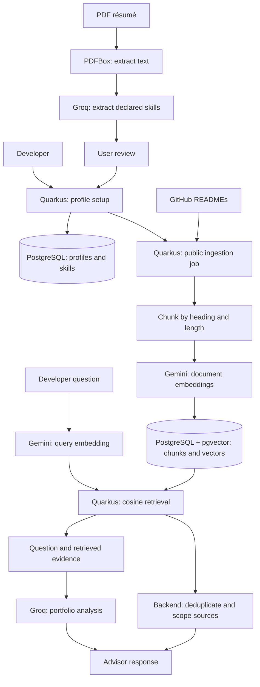
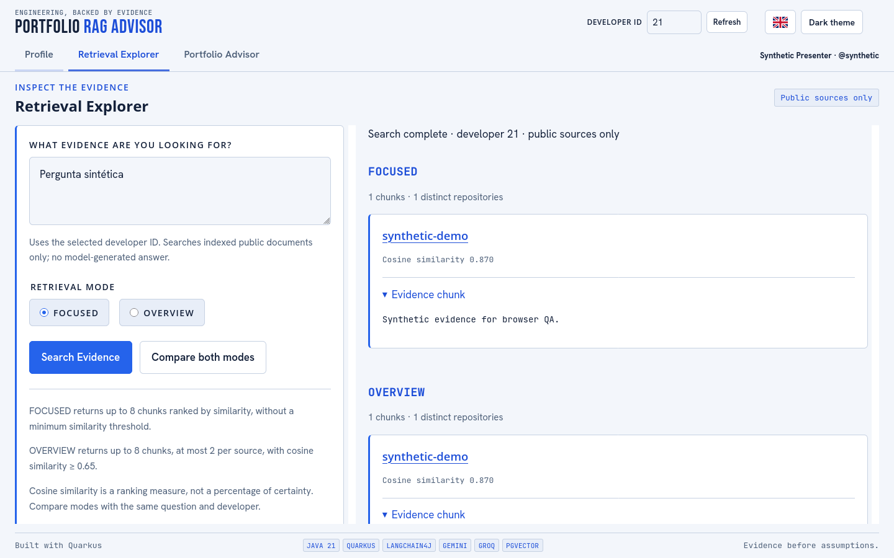
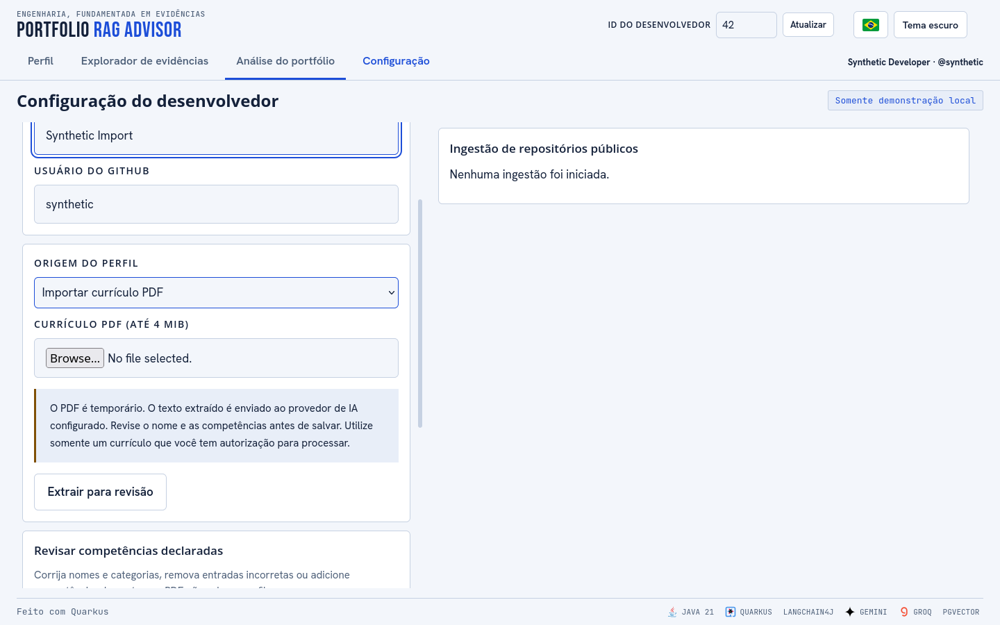

# Portfolio RAG Advisor

A Java proof of concept that uses Retrieval-Augmented Generation (RAG) to analyse a developer's portfolio from evidence retrieved from GitHub READMEs. It combines semantic search with AI-generated strengths and prioritised recommendations, with references to the documents used.

A declared technology stack does not, by itself, demonstrate practical experience. This project keeps declared skills separate from repository evidence and helps examine what the documentation actually supports. It does **not** audit the entire source code or certify a developer's competence.

The application is intended for local use and technical demonstrations. Its current access restrictions are described under [Privacy and security](#privacy-and-security).

## Features

- Developer profiles with declared skills grouped by category.
- PDF résumé extraction with editable review before saving, or manual skill entry.
- Public GitHub README ingestion through asynchronous jobs, with progress and rate-limit retry states.
- Semantic evidence search with `FOCUSED` and `OVERVIEW` retrieval modes.
- Portfolio analysis with an answer, strengths, prioritised tips and backend-generated source references.
- A Qute interface with four tabs, Portuguese and English labels, light and dark themes, and local technology logos.
- Separate internal ingestion and analysis paths that can include private repositories; these require particular care with provider access and disclosure.

## Architecture



All of these paths run within one Quarkus application, apart from PostgreSQL and external API providers. PDF import produces a profile draft; it does **not** add the résumé to the vector index. The implemented evidence ingestion path indexes GitHub READMEs.

READMEs are split at Markdown headings and into sections of up to 2,000 characters, with a 200-character overlap when splitting long sections. Ingestion creates document embeddings using Gemini `gemini-embedding-001`, with 1,024 dimensions and the `RETRIEVAL_DOCUMENT` task type. Questions use the same model and dimensions with `RETRIEVAL_QUERY`.

Storing embeddings allows subsequent questions to search existing documents without embedding every README again. PostgreSQL stores the text, source reference, developer ID, access scope and vector together. pgvector's cosine-distance operator ranks candidates within the requested developer's evidence.

RAG supplies selected documents as context rather than asking the generation model to recall a portfolio from memory. The Advisor sends the question and retrieved chunk text to the configured Groq-compatible chat model. The backend parses its JSON response and builds `sources` from the retrieved evidence, deduplicating source references and filtering `relatedRepos` against permitted repository names or aliases. The model does not generate the source list. These checks do not establish that every statement in the answer is correct.

The [application services](src/main/java/dev/erickmurakami/portfolio/application/services), [REST resources](src/main/java/dev/erickmurakami/portfolio/interfaces/rest) and [Flyway migrations](src/main/resources/db/migration) contain the corresponding implementation.

## Technology stack

| Area | Implementation |
| --- | --- |
| Runtime | Java 21, Quarkus 3.40.1.2, Maven Wrapper |
| Web and API | Quarkus REST, Jackson, Bean Validation, SmallRye OpenAPI |
| Interface | Qute, custom CSS, vanilla JavaScript; no frontend build pipeline |
| AI integration | LangChain4j, Gemini embeddings, Groq-compatible OpenAI chat API |
| Persistence | PostgreSQL 17 with pgvector, Hibernate ORM/Panache, JDBC vector queries, Flyway |
| PDF processing | Apache PDFBox |
| Background work | Quarkus Scheduler and persisted ingestion jobs |
| Containers | Docker Compose; a compatible Podman setup can also provide containers |
| Tests | JUnit 5, Mockito, REST Assured, Testcontainers, Node.js test runner; optional Firefox browser QA |

Versions and dependencies are defined in [pom.xml](pom.xml). Container services are defined in [compose.yml](compose.yml).

## Retrieval strategies

Both modes request **at most eight chunks**. Results are ordered by cosine similarity descending, then chunk ID for deterministic ties.

| Mode | Selection | Trade-off |
| --- | --- | --- |
| `FOCUSED` | Nearest chunks, with no similarity cutoff or per-source cap | Emphasises the question's topic, but one repository can dominate and weak matches can still appear. |
| `OVERVIEW` | At most two chunks per `source_reference`, each with similarity **at least 0.65**, followed by the overall limit | Encourages source diversity, but can return fewer chunks and omit useful context. |

The `0.65` cutoff is currently hard-coded in [DocumentChunkRepository](src/main/java/dev/erickmurakami/portfolio/infrastructure/repository/DocumentChunkRepository.java), rather than exposed as an environment setting. It is not a calibrated quality guarantee.

The Explorer applies `PUBLIC` scope before ranking and limiting. The internal Advisor uses `FOCUSED` retrieval and can include both public and private chunks for the selected developer. Queries filter by developer ID, but that filter is not an authorisation mechanism.

Similarity is calculated as `1 - cosine distance`. It measures vector proximity, **not** confidence, factual accuracy or a probability that the analysis is correct.

## Getting started

### Prerequisites

- JDK 21.
- Docker with Compose, or a compatible Podman/Compose environment.
- Gemini and Groq API credentials for actual embedding, extraction and analysis requests.
- Internet access to obtain dependencies and container images and to call the providers and GitHub.
- Node.js 22 or later only if running the JavaScript checks.

### Configure the environment

From the repository root:

```sh
cp .env.example .env
```

Edit `.env` locally. Use your own AI credentials and keep this file out of version control. Quarkus development mode reads the root `.env` file.

| Variable | Purpose |
| --- | --- |
| `GEMINI_API_KEY` | Required non-empty value at startup; a valid Gemini key is needed for document and query embeddings. |
| `AI_API_KEY` | Groq-compatible provider key for résumé extraction and Advisor generation. |
| `AI_BASE_URL` | Set to `https://api.groq.com/openai/v1/` when using Groq. |
| `AI_CHAT_MODEL` | Chat model read by the application; defaults to `openai/gpt-oss-20b`. |
| `GITHUB_TOKEN` | Required non-empty value at startup. Public Setup does not send it to GitHub; use a placeholder such as `unused-public-only` for that flow. A valid authorised token is needed for the internal authenticated GitHub paths. |
| `DB_URL` | Optional; defaults to `jdbc:postgresql://localhost:5432/portfolio_rag_advisor`. |
| `DB_USERNAME` / `DB_PASSWORD` | Optional; both default to `postgres` for the local database. |

The existing `.env.example` uses `AI_MODEL`; the application actually reads **`AI_CHAT_MODEL`**. Rename that entry if choosing a model explicitly. Set `AI_BASE_URL` explicitly as above: the fallback in `application.properties` differs from the Groq URL in the example.

Empty Gemini or GitHub values fail required configuration injection. A non-empty placeholder satisfies startup only; it does not grant access to a provider. There are no browser-side API keys.

### Start PostgreSQL and Quarkus

```sh
docker compose up -d postgres
./mvnw quarkus:dev -Dquarkus.http.host=127.0.0.1
```

Compose starts `pgvector/pgvector:pg17`, bound to loopback port `5432`, with a named volume for persistence. Flyway applies the schema and enables the `vector` extension when Quarkus starts. If changing `DB_PASSWORD`, use the same value for Compose and Quarkus; changing it does not reset credentials in an existing database volume.

Open the application at [http://127.0.0.1:8000/](http://127.0.0.1:8000/). Swagger UI is available at [http://127.0.0.1:8000/q/swagger-ui/](http://127.0.0.1:8000/q/swagger-ui/).

Use the database-only Compose command above for the interactive demo. The optional `full` Compose profile currently forwards to container port `8080`, while the application configures `8000`, and passes `AI_MODEL` rather than `AI_CHAT_MODEL`. In addition, packaged launches reject all `/api/v1/` operations. The full profile is therefore not a supported replacement for this development-mode workflow in its current form.

Stop the local database with `docker compose stop postgres` when finished; its data remains in the volume.

## Using the application

1. Open **Setup / Configuração** and enter a full name and GitHub username.
2. Choose manual entry or PDF import. Manual skills use the actual categories: `LANGUAGE`, `FRAMEWORK`, `DATABASE`, `ARCHITECTURE`, `TOOL` and `OTHER`.
3. For a PDF, review the extracted name and skills. Correct, add or remove entries before saving. Import returns a draft and does not create a developer automatically.
4. Save the profile. The returned `developerId` becomes the shared selection and updates the URL to `?developerId={id}`.
5. Setup starts a public-only ingestion job. GitHub repository discovery and README reads in this path do not use the server's personal token.
6. Follow the real job state: `PENDING`, `RUNNING`, `WAITING_RATE_LIMIT`, `COMPLETED` or `FAILED`. The UI shows repository counters, chunks, current repository and the next retry time when supplied. It polls the job rather than resubmitting it while waiting.
7. Once ingestion completes, open **Retrieval Explorer**, ask a question and choose a mode, or compare both modes with the same question.
8. Open **Portfolio Advisor** for an evidence-based answer and recommendations. Ask in Portuguese for a Portuguese answer, or English for English. Changing the UI language does not translate an existing answer.

A saved profile remains saved if ingestion fails. Setup can retry ingestion without creating it again. The job response contains counters and state but no detailed error-message field; the UI cannot display a provider failure reason that the API has not supplied.

For example, a local Explorer request is:

```sh
curl -X POST 'http://127.0.0.1:8000/api/v1/developers/1/retrieval?mode=OVERVIEW' \
  -H 'Content-Type: application/json' \
  -d '{"question":"What evidence describes database design?"}'
```

Replace `1` with a profile you have created and ingested. An empty evidence set returns no chunks. The Advisor also handles no evidence without calling the generation model.

## Web interface

The same Quarkus application serves Qute HTML, CSS, JavaScript and REST endpoints. There is no separate frontend server or framework.

- **Profile:** developer identity and declared skills grouped into technical stack cards. These are not verified repository evidence.
- **Retrieval Explorer:** retrieved text, repository references and cosine similarity; independent results for mode comparison.
- **Portfolio Advisor:** question form, analysis state, answer, strengths, prioritised tips and sources. Private sources have aliases and no source URL.
- **Setup:** manual or PDF-assisted profile creation, review and public ingestion progress.

An existing profile can be selected with `http://127.0.0.1:8000/?developerId=1`. Changing the selection refreshes the profile and clears evidence and analysis belonging to the previous developer. Username lookup through `?github=` is not implemented.

Tab switches preserve form inputs and results in shared in-memory state. Portuguese is the default interface language; language and theme preferences persist locally. Switching language does not fetch data again, reset the selected developer or translate API content. A reload requires API results to be loaded again.

Desktop panels scroll internally within a single-screen workspace; smaller screens allow page scrolling for readability. Technology logos are local assets with text fallbacks; their sources and licences are recorded in [the logo notice](src/main/resources/META-INF/resources/logos/NOTICE.txt). Fonts can load from Google Fonts, with system fallbacks when unavailable.

## Screenshots

These are captures of the real Qute interface using **synthetic QA profiles, evidence, job progress and model responses**. They demonstrate presentation and interaction states, not live GitHub or AI-provider results.

### Developer profile


### Retrieval Explorer



### Portfolio Advisor


### Setup and résumé review



## API reference

All paths below have the prefix `/api/v1`. **Every operation is restricted to the local development boundary**, including read-only operations. “Public-only” describes the repositories accessed, not anonymous access to a hosted API. JSON is used except for the multipart import.

| Method | Path after `/api/v1` | Purpose and content scope |
| --- | --- | --- |
| `POST` | `/developers` | Save a profile and declared skills; returns its ID. |
| `GET` | `/developers/{id}` | Read a profile and declared skills. |
| `POST` | `/resumes/import` | Extract a draft; multipart fields `file` and `githubUsername`. |
| `POST` | `/ingestion-jobs/developers/{devId}/public` | Start public-only ingestion; returns HTTP 202 and job location. Used by Setup. |
| `GET` | `/ingestion-jobs/{jobId}` | Read job state and progress. |
| `POST` | `/developers/{devId}/retrieval?mode=FOCUSED` | Public-only chunks; accepts `FOCUSED` (default) or `OVERVIEW`. Body: `{"question":"..."}`. |
| `POST` | `/developers/{devId}/advisor` | Internal analysis; can retrieve private evidence. Body: `{"question":"..."}`. |
| `POST` | `/developers/{devId}/repositories/{owner}/{repository}/ingest` | Synchronously ingest one public repository. |
| `POST` | `/ingestion-jobs/developers/{devId}` | Legacy private-inclusive job; uses authenticated GitHub access. Not used by Setup. |
| `POST` | `/developers/{devId}/repositories/ingest` | Legacy synchronous private-inclusive ingestion. |
| `GET` | `/github/{username}/repositories` | Public repository discovery. |
| `GET` | `/github/{owner}/{repository}/readme` | Public README read. |
| `GET` | `/github/me/repositories` | Repository discovery using the server's personal token. |
| `GET` | `/github/me/{owner}/{repository}/readme` | README read using the server's personal token. |

See [REST resources](src/main/java/dev/erickmurakami/portfolio/interfaces/rest) and [DTOs](src/main/java/dev/erickmurakami/portfolio/application/dto) for exact contracts. `IngestionJobResponse` exposes `jobId`, `devId`, `status`, `totalRepositories`, `processedRepositories`, `skippedRepositories`, `failedRepositories`, `totalChunks`, `currentRepository` and `nextAttemptAt`.

## Privacy and security

**This application is not ready for unrestricted public hosting.** It has no user authentication, ownership authorisation or tenant isolation. A developer ID or job UUID is not an access credential.

[LocalApiFilter](src/main/java/dev/erickmurakami/portfolio/interfaces/rest/LocalApiFilter.java) permits `/api/v1/` only in Quarkus development mode, from loopback clients, with same-origin checks for browser requests. Cross-site browser requests are rejected. Outside development mode, these APIs return HTTP 403, although the static interface can still render. This boundary is a local demo restriction, not authentication. Do not expose development mode through a public listener, tunnel, proxy or port forward; a loopback proxy does not identify or authorise its users.

Setup explicitly creates jobs with `includePrivate=false`. Public discovery and reads avoid authenticated access. Internal paths retain private-inclusive behaviour and can access repositories available to the server's token. Their token-owner check is not authentication of the person calling the application. The Advisor can retrieve private chunks already indexed under any selected developer ID within the local application.

Private sources are labelled `Private Repository 1`, `Private Repository 2`, and so on, with no URL in `sources`. **Aliases do not guarantee confidentiality.** Original chunk text is still sent to the generation provider and can contain names, URLs, client information and internal identifiers. Prompt instructions ask the model not to disclose these, but generated answers, strengths and tips are not sanitised to enforce that rule. Existing tests demonstrate this limitation.

Data sent outside the application includes:

- README chunk text and questions sent to Gemini for embeddings, including private documents when using internal ingestion.
- Questions and retrieved evidence sent to the configured Groq-compatible provider for analysis.
- Extracted résumé text sent to that provider for profile extraction.

PDF uploads are limited to 4 MiB, within the 5 MB HTTP body limit, with at most 100 pages and 100,000 extracted characters. The application deletes the temporary upload in a `finally` block after processing or failure and does not create a permanent PDF copy. These limits do not anonymise the text or control the provider's retention policy. Use only documents you are authorised to process and send.

Keep credentials on the server and out of logs, screenshots and shared recordings. Indexed text and profiles persist in PostgreSQL. Browser API results are held in memory rather than local storage; this is not a security boundary. Before public access, implement real authentication, resource-level authorisation, data isolation, upload and ingestion abuse controls, and API rate and cost limits. Provider quotas and the current upload limits are insufficient on their own.

## Testing

Run the Java verification suite with JDK 21:

```sh
./mvnw clean verify
```

Unit tests use JUnit 5 and Mockito for retrieval, analysis, ingestion, résumé extraction and related service behaviour. Qute/HTTP checks use Quarkus and REST Assured with non-empty synthetic configuration values; their profile disables database work and background ingestion. These tests do not need real provider credentials.

`DocumentChunkRepositoryTest` starts a disposable `pgvector/pgvector:pg17` database through Testcontainers and applies the production migrations. It exercises the real SQL, including ranking, the overview cutoff and source cap, public-scope filtering, deterministic ties and developer filtering, using isolated synthetic fixtures. A Docker-compatible runtime must be available. When it is unavailable, these tests are **skipped**, not evidence that vector integration passed; inspect the test summary and `target/surefire-reports`.

The default Maven configuration skips Failsafe `*IT` tests. In particular, `GeminiEmbeddingIT` calls the real provider and is separate from the mock-based default verification. Do not enable it for an offline or credential-free run.

Run the dependency-free JavaScript interaction tests separately with Node.js 22+:

```sh
node --test --experimental-test-isolation=none src/test/js/app.test.cjs
```

These use a DOM double and synthetic responses to check state, requests, language changes, rendering and Setup. They do not validate browser layout or live AI integrations.

Optional browser QA is in [browser-qa.cjs](src/test/js/browser-qa.cjs). With the development server running, start an isolated Firefox session and run:

```sh
mkdir -p /tmp/rag-qa-firefox
firefox --headless --no-remote --profile /tmp/rag-qa-firefox \
  --remote-debugging-port 19224 about:blank
```

In another terminal:

```sh
RAG_UI_URL=http://127.0.0.1:8000/ node src/test/js/browser-qa.cjs
```

The script uses the Firefox debugging endpoint on port `19224`, intercepts API calls with synthetic responses, checks desktop/mobile layout, themes and language/state retention, and writes screenshots into `docs/images`. It does not establish end-to-end provider integration.

[GitHub Actions](.github/workflows/ci.yml) runs Maven verification on pushes and pull requests to `main`. It does not run the JavaScript commands above. A local successful build does not establish the result of a remote workflow run.

## Design decisions and trade-offs

- **One Quarkus application:** REST, templates and background jobs share a runtime and database. This keeps the demonstration small, but ingestion and interactive requests share resources.
- **Qute and vanilla JavaScript:** no separate frontend deployment or build pipeline; client state and localisation remain application code.
- **PostgreSQL with pgvector:** evidence, metadata and vectors live together. Current migrations have developer/scope indexes but no approximate nearest-neighbour vector index; larger datasets need performance evaluation.
- **Gemini embeddings and Groq generation:** document retrieval and answer generation use separate providers and credentials. This also introduces separate quotas, failure modes and data-processing considerations.
- **Focused versus diversified retrieval:** the Explorer makes concentration and source coverage visible. Neither strategy guarantees complete evidence.
- **README-based evidence:** documentation is easy to ingest and inspect, but a written claim is not proof that an implementation is correct or present. The Advisor does not currently receive the declared skill list as part of its prompt.

## Limitations and future work

The following are improvements to evaluate, not existing capabilities:

- Authentication, authorisation, ownership checks and data isolation for hosted use, plus explicit cost and abuse controls.
- Deeper source-code evidence and a more systematic comparison of declared skills with implementation evidence.
- Retrieval evaluation, threshold calibration, configurable selection limits and indexing strategies for larger datasets.
- Answer-quality evaluation, stronger handling of untrusted document instructions and enforceable private-data disclosure controls.
- Better job failure diagnostics in the API and broader retry handling across providers.
- An optional MCP server integration. No MCP server is implemented in this project.

The current scope is a functional local RAG proof of concept: inspect the evidence, question the generated conclusions, and assess its limits alongside its implementation.
