# quarkus-portfolio-rag-advisor

This project uses Quarkus, the Supersonic Subatomic Java Framework.

If you want to learn more about Quarkus, please visit its website: <https://quarkus.io/>.

## Running the application in dev mode

You can run your application in dev mode that enables live coding using:

```shell script
./mvnw quarkus:dev
```

> **_NOTE:_**  Quarkus now ships with a Dev UI, which is available in dev mode only at <http://localhost:8080/q/dev/>.

## Packaging and running the application

The application can be packaged using:

```shell script
./mvnw package
```

It produces the `quarkus-run.jar` file in the `target/quarkus-app/` directory.
Be aware that it’s not an _über-jar_ as the dependencies are copied into the `target/quarkus-app/lib/` directory.

The application is now runnable using `java -jar target/quarkus-app/quarkus-run.jar`.

If you want to build an _über-jar_, execute the following command:

```shell script
./mvnw package -Dquarkus.package.jar.type=uber-jar
```

The application, packaged as an _über-jar_, is now runnable using `java -jar target/*-runner.jar`.

## Creating a native executable

You can create a native executable using:

```shell script
./mvnw package -Dnative
```

Or, if you don't have GraalVM installed, you can run the native executable build in a container using:

```shell script
./mvnw package -Dnative -Dquarkus.native.container-build=true
```

You can then execute your native executable with: `./target/quarkus-portfolio-rag-advisor-0.0.1-runner`

If you want to learn more about building native executables, please consult <https://quarkus.io/guides/maven-tooling>.

## Related Guides

- Qute ([guide](https://quarkus.io/guides/qute)): Offer templating support for web, email, etc in a build time, type-safe way
- REST ([guide](https://quarkus.io/guides/rest)): Build RESTful web services and APIs using Jakarta REST (formerly JAX-RS)
- REST Jackson ([guide](https://quarkus.io/guides/rest#json-serialisation)): Jackson serialization support for Quarkus REST. This extension is not compatible with the quarkus-resteasy extension, or any of the extensions that depend on it
- JDBC Driver - PostgreSQL ([guide](https://quarkus.io/guides/datasource)): Connect to the PostgreSQL database via JDBC

## Provided Code

### REST

Easily start your REST Web Services

[Related guide section...](https://quarkus.io/guides/getting-started-reactive#reactive-jax-rs-resources)

## Portfolio web interface

Open <http://localhost:8000/> after starting Quarkus. The Qute page and its CSS/JavaScript
are served by the same application; no frontend server or build is needed. Fonts use
Google Fonts when available, with local system fallbacks. The page contains no initial
profile or evidence data. Select an existing developer ID to fetch the declared base
stack from `GET /api/v1/developers/{id}`. Declared skills are not verified GitHub evidence.

### Local Advisor and privacy

The full Advisor form **and REST operation** are available only in the Quarkus `dev`
launch mode. Outside that mode, `/api/v1/developers/{id}/advisor` returns HTTP 403
before calling the analysis service. This is a demo restriction, not authentication.
Run a local demonstration with `./mvnw quarkus:dev -Dquarkus.http.host=127.0.0.1`;
do not expose dev mode through a public listener, tunnel, proxy or port forward.

The Advisor deliberately retains its internal retrieval behavior: evidence can include
private repositories and is sent to the configured AI provider. Aliases and missing
source URLs do **not** guarantee confidentiality. The generated answer, strengths and
tip text can contain private names, URLs, client information or internal identifiers.
Use only synthetic data or data you are authorized to send. Do not record or share a
session containing private evidence. Proper authorization or data isolation is required
before enabling a hosted Advisor. No credentials or AI calls are made directly by the
browser; it calls the existing backend. Model text is displayed as plain text.

### Public evidence explorer

`Search Evidence` uses `POST /api/v1/developers/{id}/retrieval?mode=FOCUSED|OVERVIEW`.
`Compare both modes` sends the same developer ID and question to both modes and shows
independent results or errors. FOCUSED has no similarity cutoff. OVERVIEW accepts at
most two chunks per source with similarity at least 0.65. Both return at most eight
chunks and use the backend's public-only filter. Cosine similarity is not confidence.
The UI never reconstructs a source URL from a repository name or private alias.
Profile requests use the existing GET endpoint; changing developer ID clears old
analysis and evidence and reloads the declared skills automatically.

### UI checks

Run `./mvnw clean verify` for the Java suite, including real HTTP checks for the
Qute page, CSS, JavaScript and HTTP 403 on the Advisor outside dev mode. The page
test profile disables ORM, Flyway migrations, Dev Services and background ingestion;
it does not query a real database or call AI providers.

Run `node --test --experimental-test-isolation=none src/test/js/app.test.cjs` with
Node 22+ for dependency-free interaction tests with synthetic API responses. These
exercise profile refresh/races, input validation, safe text and source rendering,
loading/error/empty states, comparison and request cancellation. They use a DOM
double and do not establish real browser layout or live Gemini/Groq integration.
The pgvector repository tests require Docker and report skipped when unavailable.


### Presentation workspace (PT / EN)

The UI uses a single `100dvh` desktop workspace. The header, developer selector and
four tabs remain visible. Controls and output scroll independently. Narrow screens
allow document scrolling for readability. Tab switching retains
form inputs, scroll positions and results without fetching again. Keyboard navigation
supports Left/Right, Home and End; Tab moves into the selected content panel.

Portuguese is the default UI language. The flag control follows the GitHub Pages pattern: the current language’s flag,
with an accessible label and tooltip describing the switch. It changes interface labels,
status messages and help text while retaining context. It never translates developer
data, repository content or model-generated analysis. Ask the Advisor in Portuguese
for a Portuguese answer (the existing model prompt follows the question's language).
Only theme/language preferences are persisted; API responses are held in memory.

Open `http://localhost:8000/?developerId=1` with an existing developer ID. Selection
loads `GET /api/v1/developers/{id}` and is shared by all tabs. Editing the ID updates
the URL, aborts old requests and clears results from the previous developer. Selection
resolution is isolated in `selectionFromUrl`; `?github=` is reserved for a future
supported lookup and currently makes no request. No username endpoint was added.

The Qute HTTP test profile supplies non-empty **synthetic** Gemini/GitHub/Groq values
to permit CDI startup without credentials. Production configuration is unchanged.
The GitHub Actions fix must still be verified remotely after the next user push.


## Telas de exemplo

Capturas da interface Qute no Firefox. **Perfil e evidências das imagens são dados
sintéticos de teste**, injetados apenas durante a captura; não são resultados reais
nem dados fixos da aplicação. Não foram feitas chamadas a Gemini, Groq ou GitHub.

### Perfil — português

Cabeçalho compacto, seleção compartilhada e competências declaradas por categoria.
A página desktop permanece dentro da viewport; o inventário usa altura natural e rola apenas quando necessário.

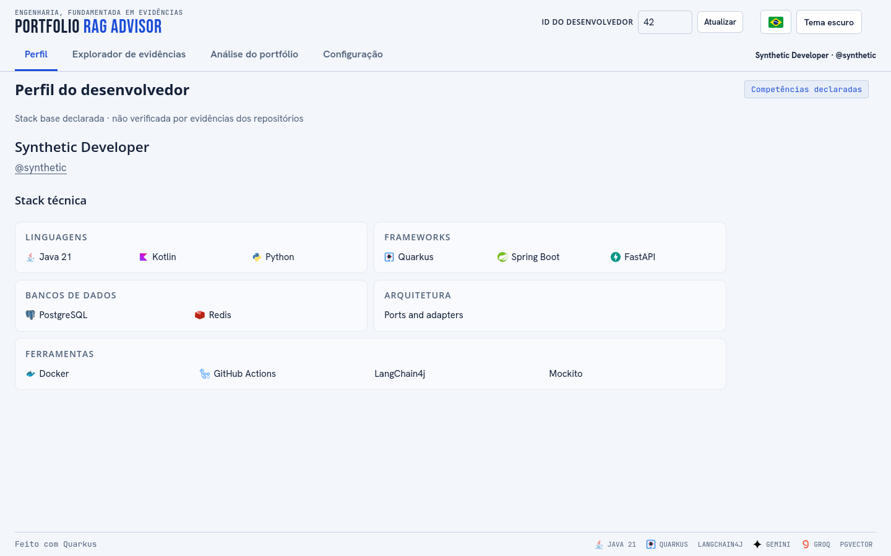

### Retrieval Explorer — English

Comparação dos modos com a mesma pergunta. Os resultados são preservados entre abas.


### Advisor — restrição local

Captura fora do modo de desenvolvimento: a análise permanece indisponível. O aviso
não representa autenticação nem garantia de confidencialidade.

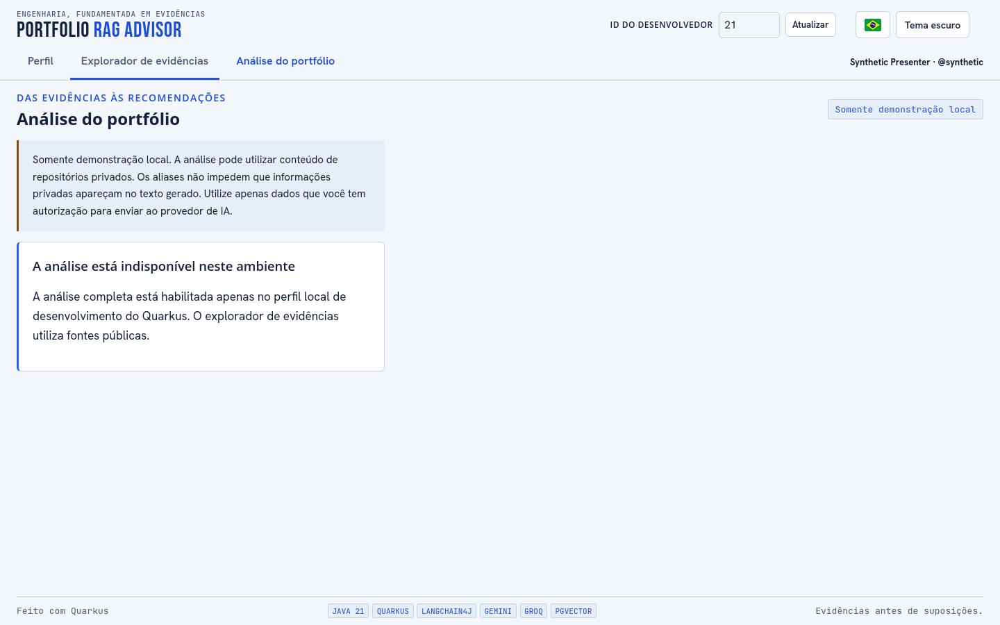

### Tela pequena

A versão mobile prioriza legibilidade e permite rolagem quando necessário.

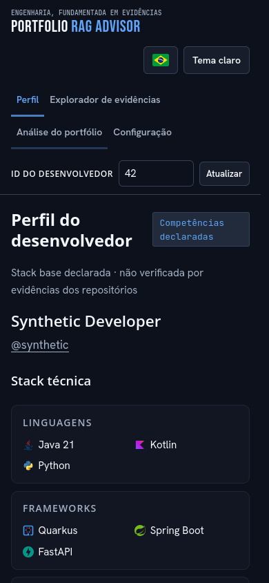


## Local developer setup

Run `./mvnw quarkus:dev -Dquarkus.http.host=127.0.0.1`, then open
<http://localhost:8000/> and select **Configuração / Setup**. Configure the existing
Gemini and Groq credentials locally to perform actual extraction and embeddings;
never put credentials in the browser. The setup flow does not use the server's
GitHub token: repository discovery and README reads use the public GitHub API.

1. Enter a name and GitHub username. Choose manual skills or PDF import.
2. PDF import calls `POST /api/v1/resumes/import` with multipart `file` and
   `githubUsername`. Review/correct the extracted name and skills. Import alone
   never creates a developer. Manual entry uses the actual `SkillCategory` values
   supplied by Qute from the Java enum, including `OTHER`.
3. Save through `POST /api/v1/developers`. The returned ID updates the shared
   selection and `?developerId=`. Only the reviewed profile is saved.
4. The UI starts `POST /api/v1/ingestion-jobs/developers/{id}/public`, which always
   creates the job with `includePrivate=false`. The legacy job endpoint retains
   its private behavior and is never used by Setup.
5. Poll `GET /api/v1/ingestion-jobs/{jobId}` for the real status, repository counts,
   chunks, current repository and next retry time. `WAITING_RATE_LIMIT` does not
   re-submit ingestion. Completion unlocks the new developer's other tabs.
   Failure permits retrying ingestion without creating another profile.

An already saved profile stays saved if starting ingestion fails. The current job
DTO has no error-message field, so the UI shows `FAILED` and the provided counters
with a generic local-configuration message. It does not invent failure details.

### Processing limits and privacy boundary

**All `/api/v1/` operations are local-demo operations**, including profile reads,
uploads, retrieval, job status, `/github/me`, private ingestion and Advisor. A request
filter rejects them outside Quarkus dev mode, rejects non-loopback clients in dev,
and rejects cross-origin browser requests. The static Qute UI can render outside dev,
but its operational APIs are unavailable. This is not user authentication, ownership
verification or tenant isolation. A numeric developer ID is never an authorization
credential. Do not expose dev mode through a proxy, tunnel or public listener;
proxying from loopback does not establish user authorization. Public deployment
needs real authorization, data isolation, rate/cost controls and an abuse review.

Uploads are limited to 4 MiB (within the application's existing 5 MB HTTP body limit),
100 PDF pages and 100,000 extracted characters before sending text to the configured
AI provider. The upload is deleted in a `finally` block after extraction or failure;
no permanent PDF copy is created by the application. Quarkus also manages temporary
multipart files. Extracted text leaves the server for the configured Groq-compatible
provider; it is not made anonymous merely by omitting the original PDF. In-memory UI
state is not saved to browser storage; only language/theme preferences are persisted.
The existing Advisor privacy limitation still applies to generated free text.

### Logos, language and browser checks

Technology labels retain the exact API skill names. The case-insensitive local
allowlist is in `js/technology-logos.js`. Unknown names (including Mockito, IRIS and
LangChain4j until a suitable transparent asset is selected) stay text-only. No profile skill is added
because an icon exists. Only displayed logos are loaded. Devicon/Simple Icons
licenses and official project mark sources are recorded in
`src/main/resources/META-INF/resources/logos/NOTICE.txt` and adjacent license files.
Where available, the exact transparent SVGs from the author’s GitHub Pages are
used (Java, Spring, Quarkus, PostgreSQL, Redis, Docker, Groq, Flyway, Hibernate).
Logos have no background tiles; monochrome marks adapt to the dark theme.

The small language dictionary initializes locale/theme in the document head before
styles paint. A body-end call translates labels before deferred application code;
only untranslated labels are briefly withheld during parsing. Language switching
runs synchronously and skips unchanged nodes, without toggling page visibility,
recreating results or making API calls. Backend data and existing Advisor prose
are never translated. The header's appearance is retained; Setup adds one requested
navigation tab. CSS/JS asset URLs are versioned to avoid stale cached styles.

`node --test --experimental-test-isolation=none src/test/js/app.test.cjs` covers
profile, retrieval, Advisor, language retention and Setup with synthetic responses.
For optional Firefox QA, start an isolated browser with
`firefox --headless --no-remote --profile /tmp/rag-qa-firefox --remote-debugging-port 19224 about:blank`
(create that profile directory first). Run `node src/test/js/browser-qa.cjs` against
an already running local dev server. `RAG_UI_URL` (default
`http://127.0.0.1:18400/`) and `RAG_BROWSER_WS` (default
`ws://127.0.0.1:19224/session`) select the server and browser. The script intercepts
all `/api` requests with synthetic fixtures, checks computed CSS rules, local logos,
both themes, locale frame samples/reload persistence, form/result retention and the
PDF-review/public-job flow. It writes example screenshots; it does not establish
live Groq/Gemini integration. The CSS check catches malformed imports that can
silently discard the root design tokens.

### Setup examples (synthetic data)


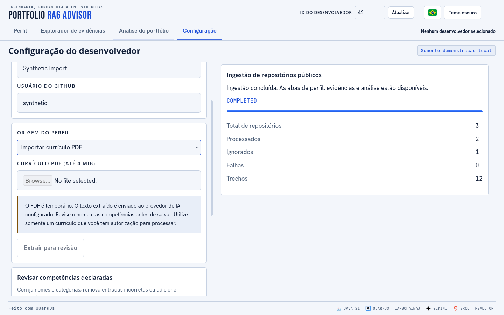

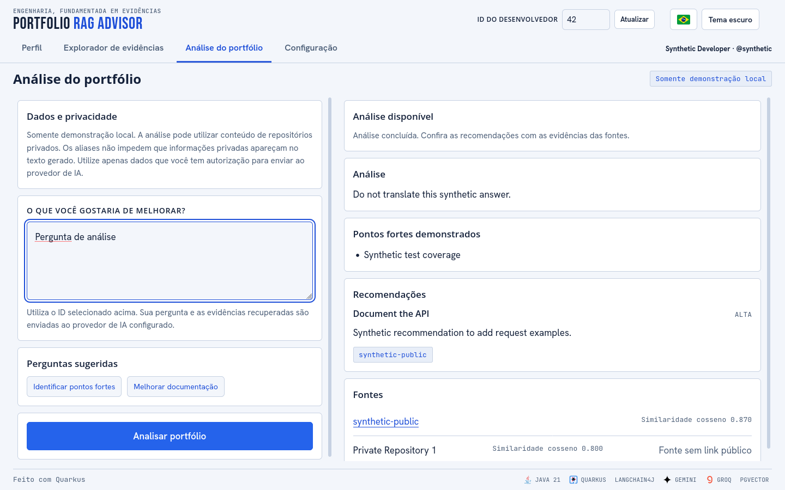

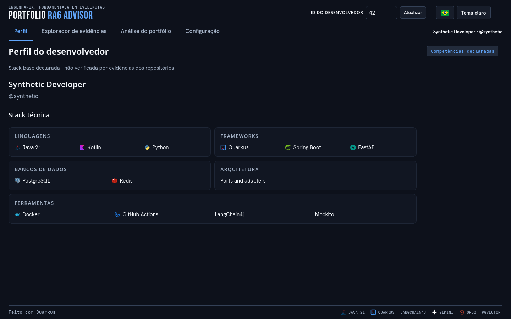


## Analysis workspace

The Portfolio Advisor keeps its two desktop columns, with separate cards for the
local-data notice, question, suggestions and primary action. The result column has
an explicit status card and content-sized cards for the answer, strengths,
recommendations and sources. Loading uses an indeterminate progress indicator;
no confidence scores or completion percentage are invented. On small screens,
the cards stack and allow document scrolling.

The analysis scrollers reserve room around focused elements. The browser QA checks
all four computed border widths/styles in normal, hover and keyboard-focus states,
and verifies that the complete focus outline fits inside both its card and scroll
panel. It checks the CTA is visible at 1440×900, no desktop document scrolling at
1024×600, stable header bounds across tabs, and idle/changed/loading/complete/empty/
error states. Questions and results persist across PT/EN and tab changes. All QA
analysis content is synthetic and no AI provider is called.

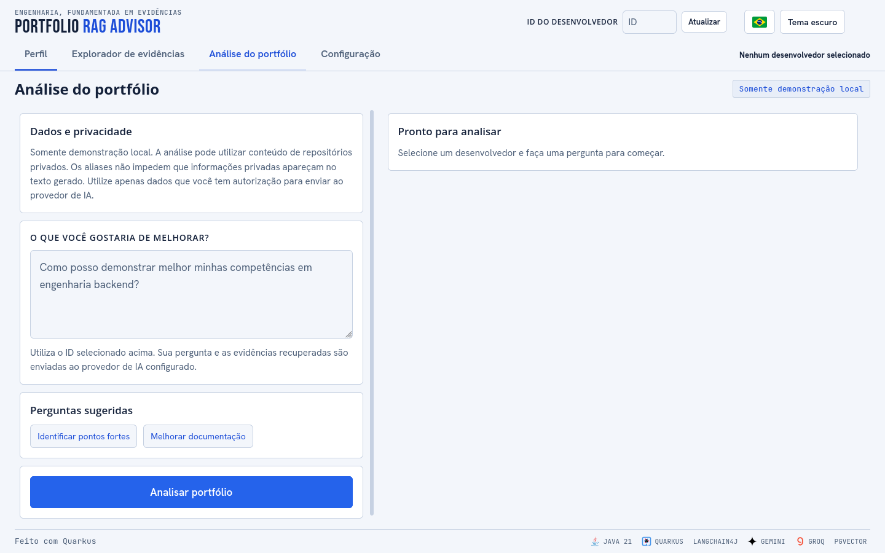

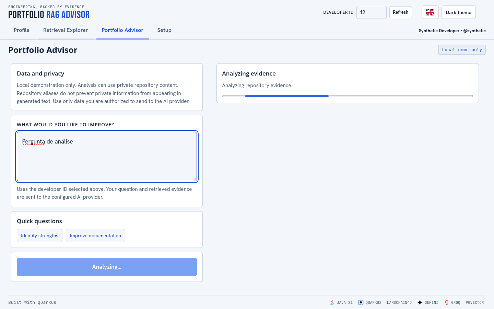

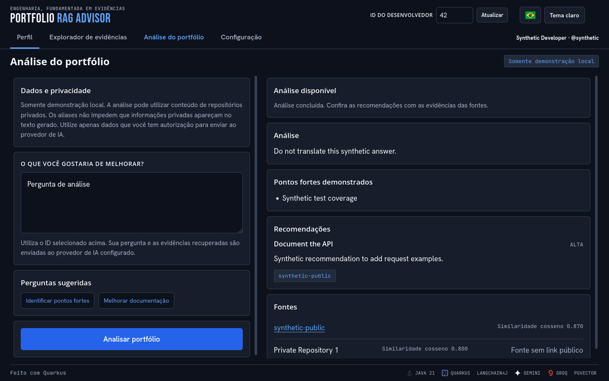

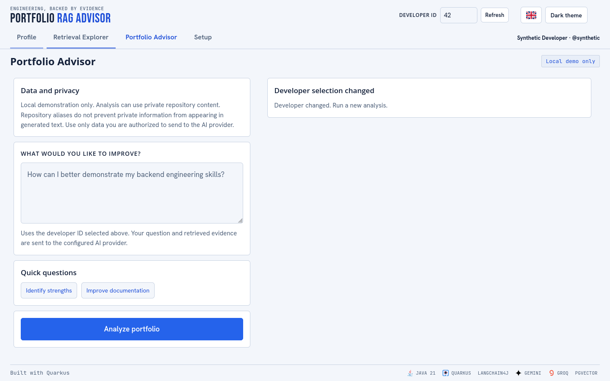

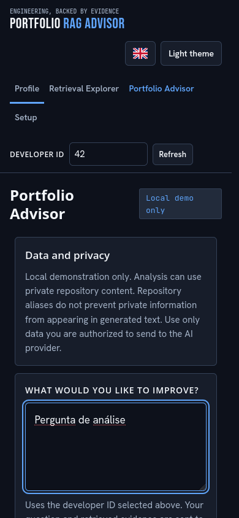

## Consistent workspace cards

Retrieval and Setup use the same card surface, border, radius and spacing as the
Advisor. Their forms, actions and status/progress are grouped without changing API
contracts or request behavior. The declared stack remains grouped by the real
skill categories, with local technology logos and text fallbacks. Browser QA checks
card rendering, field focus boundaries, state retention and both themes.

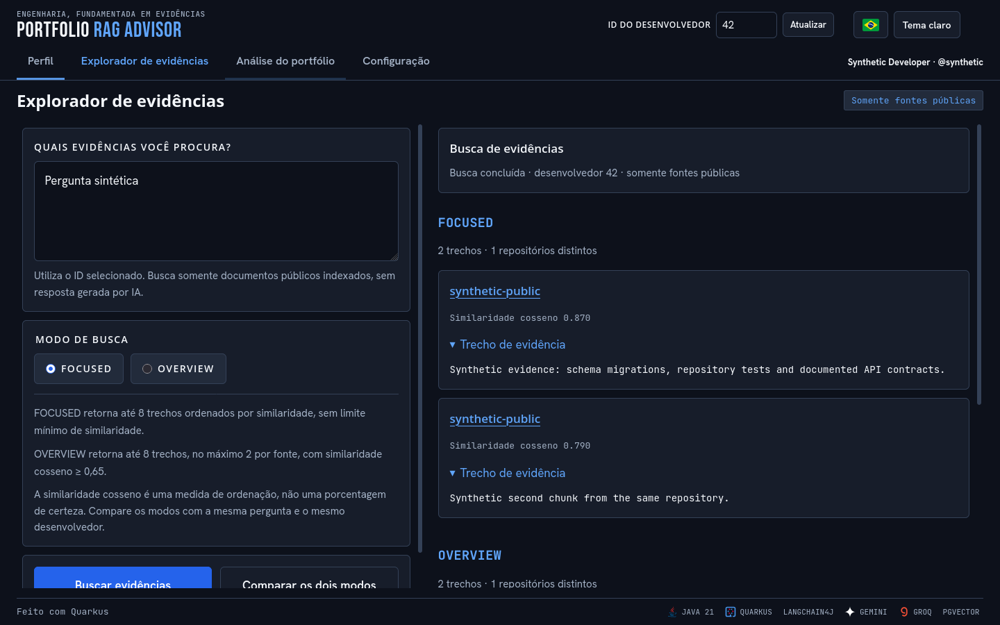

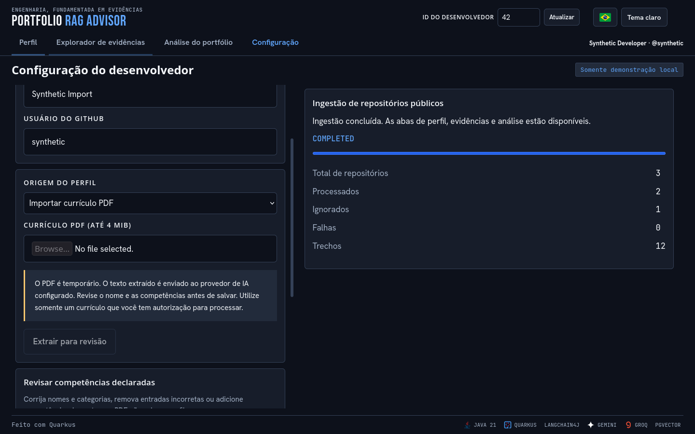
